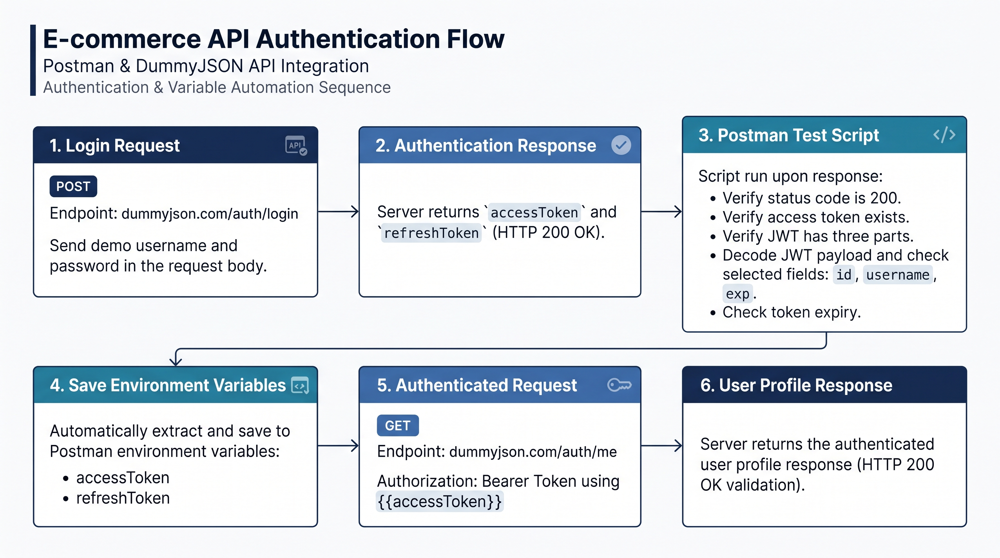
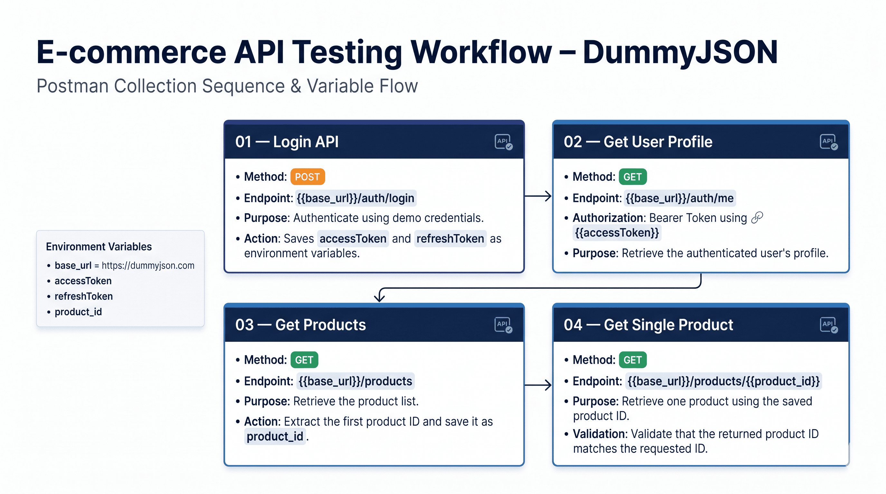
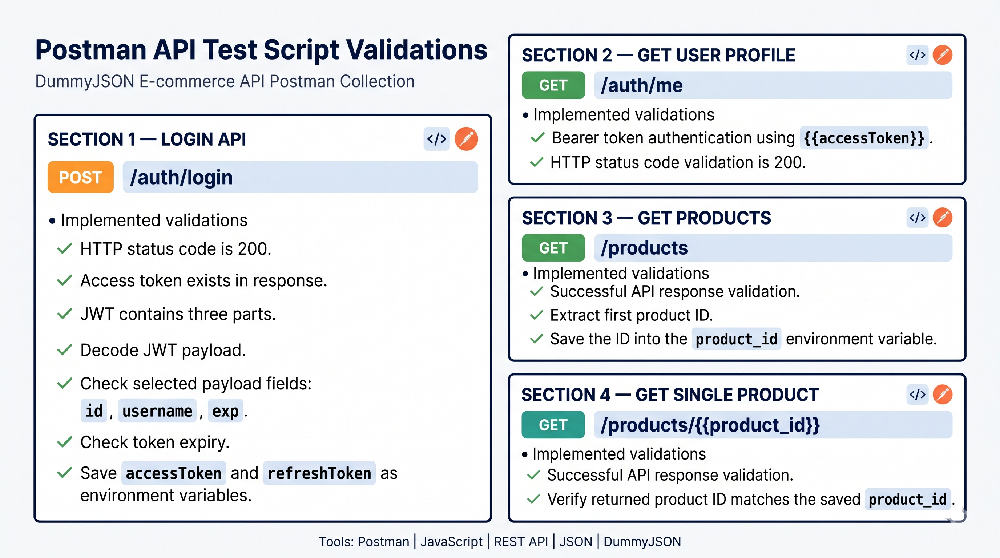

# E-commerce API Testing using Postman

A beginner-level REST API testing project using the [DummyJSON API](https://dummyjson.com). It covers authentication, Bearer tokens, environment variables, dynamic data, and response validation.

## Project Details

- **API:** DummyJSON
- **Tool:** Postman
- **Scripting:** JavaScript
- **Format:** JSON

## Requests Covered

| Request | Method | Endpoint |
|---|---|---|
| Login API | POST | `/auth/login` |
| Get User Profile | GET | `/auth/me` |
| Get Products | GET | `/products` |
| Get Single Product | GET | `/products/{{product_id}}` |

Base URL: `https://dummyjson.com` (stored in the `base_url` environment variable).

## Project Diagrams

### 1. Authentication Flow
Login, token storage, and the authenticated profile request.

### 2. API Testing Workflow
The four requests and the data passed between them.

### 3. Test Script Validations
The main response and data checks in the Postman scripts.

## Test Flow

1. Login and validate the response and tokens.
2. Save access and refresh tokens as environment variables.
3. Use the access token for the profile request.
4. Fetch products and save the first product ID.
5. Use that ID to retrieve and validate a single product.

**Note:** The refresh token is stored but no refresh-token request is implemented. JWT checks inspect structure and selected payload fields; they do not verify the signature.

## Tools and Concepts

- Postman collections and environments
- REST API testing with GET and POST
- JSON request and response validation
- Bearer-token authentication
- JavaScript test scripts
- Dynamic data extraction and reuse

## How to Run

1. Import `Ecommerce API Project.postman_collection.json` into Postman.
2. Create an environment and set `base_url` to `https://dummyjson.com`.
3. Send Login API first, then Get User Profile.
4. Send Get Products, followed by Get Single Product.
5. Review each response and its **Test Results** tab.

Use valid DummyJSON demo credentials for the login request.

## Current Limitations

- Negative scenarios are not included yet.
- No automated token-refresh flow.
- The profile request currently checks the HTTP status code only.

## Author

**Prashant Kumar**  
[GitHub Profile](https://github.com/prashantkumar1122)
